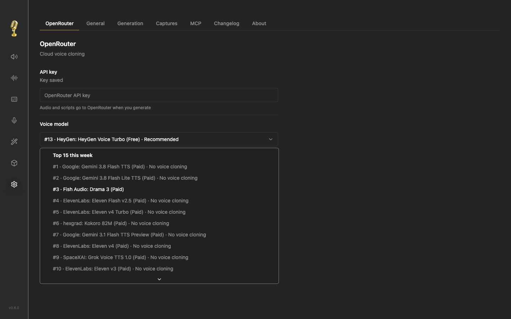

# Voicebox OpenRouter



This fork adds cloud voice cloning to Voicebox's existing profiles, generation history, downloads, retries and queue. The upstream README and MIT license are preserved.

## Use it

1. Open **Voicebox OpenRouter**.
2. Open **Settings → OpenRouter**, paste your key, click **Save**, then **Check**.
3. Choose a model from the weekly rankings. **HeyGen Voice Turbo (Free)** remains the initial choice; changing rankings never change your saved selection.
4. Create a cloned voice profile. Upload or record clear samples of your own voice. OpenRouter profiles allow up to **3 minutes total**, including short pauses between samples. Local voice engines keep their 30-second sample limit. Reference text is optional for OpenRouter. If supplied, it must match the recording exactly.
5. Choose **OpenRouter** in Generate, select the profile, enter your script and generate. Download the completed audio from history.

Every recording in the selected profile is combined into one reference file. The three-minute limit is checked before generation; an overlong profile gets an error without dropping recordings or clipping speech. A transcript is sent only when every sample has reference text.

The fork checks the provider's current voice-cloning support before generating. Free Turbo uses the exact `:free` model. If it is unavailable, generation stops. It never falls back to a paid model. Paid options charge your OpenRouter key. Audio and scripts are sent to OpenRouter and its selected provider only when you generate.

## Weekly model rankings

Settings and Generate show OpenRouter's **15 most popular text-to-speech models for the week**, in descending request order. Names, model IDs, free variants and voice-cloning support come from OpenRouter. There is no fixed model list.

The app refreshes hourly while the model list is open and checks again when you return to it after an hour. **Refresh** checks immediately. The latest successful list is saved locally; if OpenRouter is unavailable, the app marks that list as outdated instead of inventing rankings. Your selected model stays available separately if it falls outside the top 15. Refreshing never changes your model or starts a generation.

All 15 ranked models are shown. Models without current reference-audio cloning support are labeled **No voice cloning** and cannot be used for this cloning flow. Availability is checked again before generation. Free and paid versions are separate entries. A free selection never falls back to a paid model.

Source: [OpenRouter weekly speech rankings](https://openrouter.ai/rankings/speech?view=week), licensed under [CC BY 4.0](https://creativecommons.org/licenses/by/4.0/). The app displays when it fetched the data. The provider's `week` view is used as published; it is not relabeled as a guaranteed rolling seven-day window.

The integration uses the public JSON feed used by OpenRouter's speech rankings page, joins its permanent IDs to the current speech catalog, sums requests for each distinct variant and takes the top 15. This public frontend feed is not a versioned API contract, so a future schema change can require an app update. A failed refresh retains the last successful list with a visible message.

References: [weekly rankings feed](https://openrouter.ai/api/frontend/v1/rankings/modality-models?routeSegment=speech&view=week), [speech catalog](https://openrouter.ai/api/frontend/v1/models/find?output_modalities=speech), [voice-cloning guide](https://openrouter.ai/docs/guides/overview/multimodal/tts), and [speech API](https://openrouter.ai/docs/api/api-reference/tts/create-speech).

## Private data

The API key is saved on the server in a user-only file outside this repository. The UI never receives the saved key. On macOS, the key file is under `~/Library/Application Support/voicebox-private/`; recordings and history for this app are under `~/Library/Application Support/com.gng.voicebox/`.

The native app listens on this Mac by default. Do not expose the server publicly without adding authenticated access. The fork has its own app identity and does not install upstream app updates automatically. It uses the same local server port as upstream, so run one Voicebox server at a time.

## Build and checks

Use upstream's Python 3.12 setup and Bun dependencies. Then build with `bun run build`. The OpenRouter integration needs no local voice model download.

Focused checks:

```sh
python -m pytest backend/tests/test_openrouter.py backend/tests/test_openrouter_catalog.py backend/tests/test_browser_write_origin.py backend/tests/test_generation_engine_resolution.py backend/tests/test_profile_duplicate_names.py backend/tests/test_profile_delete_cascade.py backend/tests/test_generation_download.py backend/tests/test_task_queue_cancellation.py -q
bun run typecheck
bun run build:web
```

Provider response tests use simulated audio and fake credentials. They check decoding, saved audio, retry behavior and error handling. They do not measure real voice similarity.

The weekly rankings update passed **164 focused backend tests**, TypeScript checks and the production web build. A live comparison confirmed the 15 model IDs, request counts and ranking order against OpenRouter. Browser checks covered forced refresh, a saved selection outside the top 15, automatic refresh based on the snapshot age, new model arrival, preserved selection and a visible saved-list message after a failed refresh. The automatic-refresh and failure cases used controlled browser responses. [Watch the rankings preview](docs/openrouter-walkthrough.mp4).

The updated Apple Silicon app was built, installed and checked in both Settings and Generate. Native Refresh fetched a new ranking snapshot. A real request to the newly discovered `fish-audio/s2.1-pro-free:free` completed through the UI and returned a valid 2.795-second WAV through the playback endpoint. The saved HeyGen Turbo Free default and original voice files were preserved. Paid models were not generated during this update. Voice similarity was not scored.

The earlier free-model and sample-handling update passed 132 focused backend tests, including three-sample ordering, pitch and duration preservation, partial transcripts, the combined limit, repeatable legacy-data migration, and refusal to fall back from free to paid. TypeScript and production builds passed. Browser checks recorded 32.1 seconds, accepted a 35-second additional cloud sample, and rejected that file for a local profile.

The updated Mac app was installed and checked. Free Turbo is selected in both Settings and Generate. A real request to the exact `:free` model completed successfully with all three existing reference samples. The assembled 71.592-second reference was checked against the original PCM audio, with all source frames preserved and only short gaps added between clips. Original recordings remained unchanged. The resulting voice preview stays in private app storage and is not included in this repository.

Earlier checks covered saving and removing a test key, a real rejected-key response from OpenRouter, model persistence, blank transcripts, sample counts, and selection after deleting a profile. The original Apple Silicon app was built, installed and opened. Temporary test profiles and the test key were removed. Its first sample took about 36 seconds to prepare.
